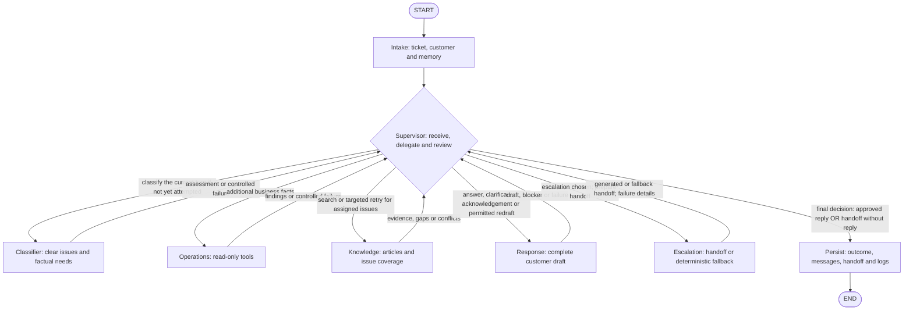
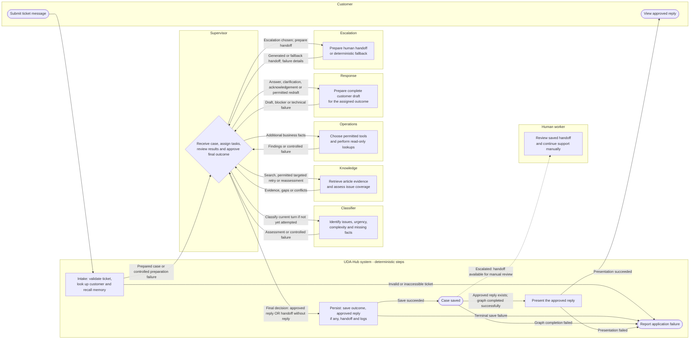

# UDA-Hub — Multi-Agent Architecture Design

**Project:** nd901 Course 3, Autonomous Knowledge Agent

**Account:** CultPass

**Author:** Burak Kilic

**Updated:** 2026-10-14

**Status:** submission design agreed and implemented. Node, tool and agent bodies are
implemented with a passing local test suite and no skipped tests. Part A specifies the
version built. Part B records future work and is explicitly outside the submission
implementation target.

# Part A — Submission design

## 1. Purpose and scope

UDA-Hub processes existing CultPass support tickets. It identifies each customer
issue, obtains business facts and support guidance, prepares a customer response,
or preserves the unresolved case for a human.

The business database contains customers, subscriptions, reservations and
experiences. Business access is read-only. The support database contains accounts,
users, tickets, metadata, messages and knowledge articles. Support records, logs,
checkpoints and approved customer memory can be written. No payment ledger, refund
execution, cancellation execution or other business write is included.

The notebook demonstration processes pending customer messages from open
database tickets one at a time through `utils.batch_interface`. The stored
message ID identifies the turn; the ticket ID identifies its checkpoint thread.
Notebook 02 seeds additional email tickets with explicit increasing timestamps,
including a same-ticket clarification/follow-up example. The original starter
ticket retains its supplied channel. Response formats email subject/body for
email tickets; the notebook displays saved approved wording without sending it.
There is no email sender, receipt system or live channel integration.
The manual `chat_interface` remains available for optional experimentation.

| Outcome | Meaning |
|---|---|
| `resolved` | Every issue has a supported answer and essential information is present. Guidance does not imply a requested business action was executed. |
| `information_requested` | The customer must provide specific details; ticket status remains open. |
| `escalated` | The case is preserved for a human, with an approved acknowledgement when possible or no automatic customer reply. |

The governing rule is: **an unreviewed message is never delivered, but a handoff
can be saved without a customer message**. A failed database write must not be
reported as a successfully saved handoff.

## 2. Pattern and responsibility boundaries

Use the Supervisor pattern with six specialized agents and two deterministic
nodes. Classifier identifies the work, Supervisor assigns it, and specialists
choose their own permitted tools. Response owns wording; Supervisor owns review.
Escalation prepares the handoff after Supervisor chooses escalation. Supervisor
is the first agent after Intake and the last agent before Persist. Classifier,
Knowledge, Operations, Response and Escalation all return their results to
Supervisor; no specialist hands the case directly to another specialist or Persist.

My reasons at the time:

- “direct lookup in intake, with six agents and a separate response agent. That keeps the flow simpler and responsibilities clearer.”
- “if I give this role to supervisor, it needs to select all agents tools … it will be too much job for supervision” — excerpt of my explanation.
- “the review must check the draft against both support articles and tool results, and check whether the request was actually handled.”

LangGraph connects the nodes and owns shared state, routing and checkpointed
execution. LangChain supplies prompts, chat-model calls, structured outputs,
decorated tools and article retrieval inside those nodes. Section 5.9 maps these
constructs to the actual lesson notebooks; the project uses both frameworks
explicitly, with the same readable node-function style.

Intake prepares the case and Persist saves the outcome. They are ordinary code,
not agents. Supervisor routing, counters and terminal guards are deterministic.
Its model calls are draft review, including the already bounded technical
retry/repair of that review, and one lookup-planning call before an Operations
assignment. Classifier and Knowledge supply the semantic
assessments that routing consumes. A failed review-model call cannot prevent
escalation.

## 3. Workflow

Intake prepares the incoming message, then Supervisor receives the case and
assigns Classifier when normal handling is possible. Classifier returns its
assessment; Supervisor then decides whether to obtain business facts, retrieve
guidance, ask for missing details, or escalate. Every specialist returns to
Supervisor before the next assignment or final outcome is chosen.

Normal escalation follows Supervisor -> Escalation -> Supervisor -> Response ->
Supervisor -> Persist. If generation or review cannot finish, Supervisor selects
Persist to save the handoff without a message. A fallback handoff also returns through Supervisor's
deterministic terminal handler, which disables messaging and selects Persist
without another model call. An existing handoff is not generated again, and the
acknowledgement cycle cannot restart. Supervisor makes the final approval/outcome
decision; Persist performs the actual save and reports its result.

This diagram shows the executable graph. Persist handles its permitted write
retry internally, returns success or controlled failure in `persistence_result`,
and has one fixed edge to END on normal return. END means graph execution ended;
it does not certify a successful save. The application checks the persistence
result before displaying any reply and reports failed saves without claiming a
saved handoff. Unexpected execution/checkpoint errors also go to application
error handling. No application-failure node is added to this graph. A successful
save is not proof of delivery; presentation follows section 5.6.

The entry wrappers return controlled preparation/classification errors to Supervisor.
They may skip a model call when a blocked account or fatal preparation error already
prevents normal handling. Invalid or inaccessible tickets produce an explicit
application error; no nonexistent ticket or saved handoff is invented.

### 3.1 Role swimlane process map

Each requested role has its own area: Customer, Supervisor, Classifier, Knowledge,
Operations, Response, Escalation and Human worker. A separate UDA-Hub system area
contains Intake, Persist and local presentation; these steps are not agents.
Mermaid subgraphs separate responsibilities, while the renderer determines their
placement; they do not enforce equal-width swimlanes. This broader process map
includes application handling: Case saved, presentation and Report application
failure are process steps, not additional LangGraph nodes or conditional outgoing
edges from Persist. The executable graph remains the one in section 3.

The saved visual is [process_map_swimlane.png](process_map_swimlane.png).

Supervisor receives the prepared case, assigns classification, and uses the
returned assessment to choose the next task. All five specialists return to
Supervisor, including Escalation. Specialists still choose their permitted tools;
Supervisor owns case routing, acknowledgement permission, customer-message review
and the final decision before Persist. The dotted human-worker connection means a
saved handoff is available for manual review, not that a worker has been notified
or has accepted it. Manual handling is outside the automated graph.

## 4. Agent contracts

### 4.1 Supervisor agent

**Single responsibility:** assign focused tasks, manage unresolved issues and
retries, choose the outcome, and review customer drafts. It does not query data,
select individual specialist tools, or write customer wording.

**Model use:** apply the routing table, retry counters and stopping rules in code.
Call the model through `review_response` when a draft needs review, and through
`plan_operations_lookups` before an Operations assignment; the review
helper returns structured findings and never chooses the destination or rewrites
the response. For an escalation receipt, a validated draft with explicitly empty claim
and question lists, the code sets grounded and complete as satisfied, because there
is no claim to ground; the model still judges correct outcome and channel format. For resolved
answers the reviewer also lists `unsupported_sentences`, every draft sentence it finds in no
article or record. A listed sentence that lies inside a mapped claim, or that is the
returning-customer acknowledgement, is judged through that claim or through memory; a listed
sentence that no claim covers fails the grounding check in code and is written into the
grounding findings and revision reasons. Clarifications are exempt, because the reviewer listed the
clarification question itself on a live run.
A computed list of sentences without a claim was tried earlier and withdrawn because it turned
the review into a coverage check.
A visit to Supervisor does not itself imply a model call. Log actual
calls, including permitted retries, rather than assuming a fixed count per ticket.

**Inputs:** prepared case and current request from Intake, checkpointed conversation;
Classifier assessment or controlled failure when available;
current-turn account facts, Operations results and Knowledge evidence; draft,
review history, handoff, failure results, and correction history.

**Outputs:** `Command` with state updates, next agent, assigned issues and facts
needed, intended outcome, review reasons and acknowledgement permission. Every routing
decision, including the Classifier dispatch and every terminal stop, is recorded as a
`routing_decision` trace event carrying the destination, the assigned agent, the issue IDs
and the fixed task text; one helper writes it for the early exits and the ordinary routing
block writes it for the rest. Exceptional routes keep their own events as well (step limit,
budget stop, draft blocker, review, terminal failures). The application renders a turn's
routing events as one readable line, for example `email -> intake -> supervisor ->
classifier -> supervisor -> knowledge -> supervisor -> response -> supervisor -> persist ->
customer (answer)`, so the saved run shows the route each case took.
Classifier is a Supervisor-assigned destination. After each specialist returns,
Supervisor chooses the next task or authorizes the final outcome for Persist.
It does not repeat classification once the current-turn assessment or terminal
classification failure is recorded. Terminal guards run before classification;
missing classification is not a reason to restart a completed or failed attempt.

**Success:** every issue is accounted for; complete evidence precedes a resolved
draft; the exact delivered draft has approval; terminal failures preserve the case
when support storage is available.

**Failure / retry:** apply section 5.3. Specialists cannot obtain fresh retry
allowances by receiving the same task again. A deterministic terminal handler can
choose escalation and disable messaging even when the review model is unavailable.

### 4.2 Classifier agent

**Single responsibility:** express the request as clear issues, urgency, complexity,
missing details and possible factual needs. It does not fetch data, assign agents,
choose tools, decide evidence sufficiency or answer the customer.

**Inputs:** Supervisor's classification assignment, latest customer message,
relevant checkpointed conversation, verified customer/account facts from Intake,
channel, and relevant memory already supplied. Subscription and reservation details
are not fetched automatically for classification. The assessment or controlled
failure returns to Supervisor; Classifier chooses no next agent.

**Outputs:** valid assessment with one or more issues, each with a stable ID, task
description, category, missing details/reasons and possible Operations needs.
An output failure is distinct from a valid `unknown` or `unsupported` issue.

| Category | Boundary |
|---|---|
| `account_access` | Login, password reset and blocked/access problems. |
| `subscription` | Plan, status, quota, cancellation or pause guidance. |
| `reservation` | Booking guidance or a particular reservation. |
| `experience_information` | Event time, location, description, availability or premium status. |
| `unknown` | The customer's intended issue cannot be understood yet. |
| `unsupported` | The request is understood but outside the stated support scope. |

One request may contain several issues. “Cancel my subscription” is a subscription
issue even though the agent cannot execute cancellation. Missing details may be
available through Operations instead of requiring a question to the customer.
One issue per distinct request: the same request in two wordings is one issue, a
stated communication preference is recorded as a preference and never as an issue,
an out-of-scope request is one `unsupported` issue, and a vague request is one
`unknown` issue. The wrapper enforces part of this structurally before validation; which
requests are distinct and whether a vague request is unknown rather than unsupported
still depend on the model. It removes
placeholder entries such as "none" from required business facts, collapses issues whose
task text is identical after normalisation, or contained in the other when one reading is
unknown or unsupported (two classified requests are never merged; a classified reading is
kept over an unknown or unsupported one; unknown against unsupported on the same text is
sent to the one repair call, after which the first reading stands), and drops `unknown` issues
when a classified issue is present. Asking the model to confirm these cases instead was tried
and withdrawn: it kept the hedge two times in three and blocked the answer behind a
clarification. The accepted cost is that a genuine second vague remark beside a clear request
is not acted on in that turn and must come back as a follow-up.
Missing information or required facts that name a credential are removed in code and counted.
A stated preference that is not a quote from the current message, for example one
copied from recalled memory, is dropped and counted rather than failing the turn.
The classification event records the failed check of an invalid output, and the one
repair call receives that check.

Urgency is `normal` or `urgent` with a concrete reason; negative sentiment or channel
alone does not establish it. Complexity is `simple` for one clear issue and `complex`
for several/interdependent issues. A lookup is a dependency, not automatically
complexity. In this version these labels provide assessment/handoff context; there
is no priority scheduler or rule that urgency bypasses retrieval. Category and
verified account metadata drive the concrete routing examples in section 5.2.
Persist both `urgency` (with its reason) and `complexity` in the classification
event and include them in generated and deterministic handoffs. If classification
was skipped or failed, record the fields as unavailable with that reason; do not
invent labels to fill the handoff.

**Success:** identify each distinct request without inventing facts, issues or routing decisions.
**Failure / retry:** retry malformed output once, then return technical classification
failure. Valid `unknown` returns the needed clarification to Supervisor. Model-call
errors follow the separate technical rule in 5.3.

### 4.3 Knowledge agent

**Single responsibility:** retrieve articles for assigned issues and assess
relevance, sufficiency, source traceability, applicability and consistency within
the retrieved evidence. No business lookups, customer wording or case disposition.

**Inputs:** assigned issues, current request and relevant existing context, verified
business facts, current-turn article list and per-issue attempts.

**Outputs:** articles with IDs, titles, excerpts and relevance scores; references to
the issues each supports; and coverage per issue: `supported`,
`targeted_retry_needed`, `awaiting_business_facts` or `evidence_problem`, with reasons.

| Check | Meaning |
|---|---|
| Relevance | Article addresses the issue according to the retrieval gate. |
| Sufficiency | Guidance covers the answer and applicable conditions/exceptions. |
| Traceability | IDs and excerpts match actual CultPass article records. |
| Applicability | Conditions match verified facts, or missing facts are identified. |
| Consistency | Conflicting passages within retrieved evidence are flagged. |

Traceability is checked in code. Semantic assessments include excerpts and reasons.
Each structural contradiction in an assessment raises its own named message, which the
single repair call receives. Items that ask for a secret value (password, PIN, one-time or
verification code, security answer, login credentials) are removed from required facts and
missing information in code, because they can neither be looked up nor asked for; information
about a credential process, such as the error shown on the reset screen, is kept. When nothing
else was missing the guidance applies. Facts listed under applicability `applies` are dropped only
when they match a fact a completed lookup was asked for this turn; otherwise the assessment goes to
the repair call with a message asking for `missing_facts` or no facts.
Update timestamps do not prove approval or freshness. No detected conflict is not
proof that none exists elsewhere. No arbitrary “reliability score” is introduced.

**Success:** return evidence or precise gaps for every assigned issue, without
inventing policy or discarding another issue's accepted evidence.

**Failure / retry:** finish the initial search pass across the request's pending
issues before concluding that no relevant knowledge exists at all. No relevant
evidence means immediate escalation. Partial/insufficient evidence permits one
targeted retry **per unanswered issue and turn**. Continued insufficiency, source
failure or conflicting guidance is reported for escalation. Missing applicability
facts go to Supervisor for Operations or clarification. Reassessing existing
articles against new business facts does not consume another search.

### 4.4 Operations agent

**Single responsibility:** obtain assigned business facts with permitted read-only
account, subscription, reservation and experience tools. Supervisor specifies what
must be established; Operations selects tools and the necessary lookup sequence.

**Inputs:** focused task, issue IDs, requested facts, trusted account/customer scope,
relevant customer-supplied search details and current-turn results.

**Outputs:** structured facts, source record IDs, issue/turn IDs, tool name,
`lookup_key`, outcome and attempt. Technical failures include stable `error_code`
and deterministic `retryable` classification supplied by the tool layer.

| Outcome | Meaning |
|---|---|
| `found` | Matching records returned. |
| `not_found` | Lookup completed without matching records. |
| `ambiguous` | Available details do not distinguish multiple matching records. |
| `missing_input` | A required lookup detail is absent. |
| `technical_failure` | Tool/database could not complete the lookup. |

`lookup_key` combines tool name and normalized inputs, including trusted scope.
Reuse completed same-turn results for the same key; an empty completed result is
valid, while a failure is not evidence that a record does not exist. Normalization
must preserve the lookup's equality semantics; do not merge distinct stored email
values by lowercasing them only for the key or query.

The shared enum does not imply that every tool can emit every outcome:

| Tool / lookup mode | Possible outcomes | Cardinality rule |
|---|---|---|
| Customer by exact customer ID or exact stored email | `found`, `not_found`, `missing_input`, `technical_failure` | Both keys are unique; at most one row, never `ambiguous`. |
| Subscription by customer ID | `found`, `not_found`, `missing_input`, `technical_failure` | Subscription `user_id` is unique; at most one row. |
| Reservation by exact reservation ID | `found`, `not_found`, `missing_input`, `technical_failure` | Unique record ID, checked against the trusted customer. |
| Reservation identified by customer and event/date details | `found`, `not_found`, `ambiguous`, `missing_input`, `technical_failure` | More than one matching candidate may require clarification. |
| Experience by exact experience ID | `found`, `not_found`, `missing_input`, `technical_failure` | Unique record ID. |
| Experience identified by title/date/location | `found`, `not_found`, `ambiguous`, `missing_input`, `technical_failure` | Titles and descriptive combinations are not assumed unique. |

A request to list matching records can return `found` with a list. `ambiguous`
applies when the assigned task needs one record and the available details cannot
identify which one. Tests follow each tool/mode's possible outcomes.

**Success:** accurate scoped facts, no invented values, no unnecessary duplicate
lookups. No business writes, articles, customer messages or outcome decisions.
**Failure / retry:** retry only a tool-classified transient failure once; otherwise
return the failure. A lookup with no authorised mode is reported as unavailable and the
Supervisor continues to Knowledge with the completed lookups; other failures lead to
escalation. Return missing/ambiguous results for Supervisor's
next-step decision. Do not interpret raw exceptions with the model.

### 4.5 Response agent

**Single responsibility:** prepare complete readable wording for the Supervisor's
outcome. It may combine answers but cannot omit assigned issues, change outcomes,
fetch information or deliver messages. Supervisor returns revision reasons rather
than rewriting the response.

**Inputs:** channel, intended outcome, issues, request/context, accepted articles,
verified facts, the verified customer name from the prepared account context, exact
missing details or handoff, and previous draft/review reasons.
Recalled customer memory reaches Response as type, content and outcome only, with no
IDs or references and with identical notes collapsed, so nothing in it can be cited as
evidence. Issues reach Response as facts (ID, category, task, status, coverage, article
IDs, missing details, required facts) without the Knowledge agent's reasoning sentences,
which the model otherwise copies into the claim field. A claim that cites an article UUID
or a lookup tool name is resolved to its catalog key and stored as the key.

**Outputs:** draft body (and subject for email), draft ID, outcome, addressed issue
IDs, factual claim-to-evidence mapping, clarification-question basis, the declared
returning-customer acknowledgement with its source, and any blocker.
A citation is not proof: Supervisor checks the actual claim against its source.

| Mode | Required content |
|---|---|
| `resolved` | Supported answers to every issue and relevant next steps; no claim that a write action occurred. For a returning customer the body opens with the acknowledgement described below. |
| `information_requested` | Exact missing details requested; case remains open. Questions may follow Classifier/Supervisor instructions, but accompanying business claims need verified evidence. A claim mapped only to the assignment is procedural wording; its mapping entry is removed and counted while the sentence stays in the draft, rather than failing the draft. |
| `escalated` | A brief receipt: the request was received and passed to human support and is in progress. No business facts, account status, cause, resolution claim, notification or response-time promise; the claim map and question list are empty. A fixed list of timing and contact phrases (for example "shortly", "as soon as possible", "will be in touch") and the verified account values of the case (blocked status, lookup status and tier) are checked in code across the subject and the body; an offending subject is replaced by the default subject, an offending body sentence is removed and counted, and the draft goes to the one repair call when nothing is left or when the remainder no longer says the request was received and passed on. |

Chat needs a clear body and has no greeting or closing. Email formatting needs subject,
greeting, body and closing; when the model leaves the subject, greeting or closing empty,
the application fills a fixed default and records the filled field names in the draft,
because framing is boilerplate rather than a business claim. The body is never defaulted.
Keep internal IDs, raw errors and review information outside customer wording.

A returning customer, one whose recalled memory holds a resolved issue, must notice that
the system remembers them, so two replies to the same request are not identical. The
model is asked to open a resolved answer with one natural sentence that acknowledges the
earlier help or a stated preference, and to declare that sentence in
`history_acknowledgement`, a required field; for a returning customer the instruction is
repeated as its own message next to the recalled memory, because a rule inside the long
system prompt was ignored on a live run. The application accepts the declared sentence when it is in
the body, signals earlier contact (a fixed marker list: "welcome back", "before",
"you asked" and similar) and names something the memory names; otherwise it accepts the
body's opening sentence when that one qualifies; otherwise it opens the body with a fixed
sentence, "We helped you with this before, so here is the guidance again" when the
earlier help shares its topic words with the current issue, or a neutral welcome back
when it does not. The source of the sentence (model, body or application) and the
memory IDs behind it are recorded in the draft. The code requires the sentence only on
resolved answers; the reminder is given for every reply to a returning customer, so the
model may greet them in a clarification or receipt as well, and the reviewer judges that
sentence through memory. A first-time customer never gets one. For email, a generic greeting is
replaced by "Hello {first name}," from the verified account record; a greeting that
already names the customer stays. Memory remains context, never evidence for a
business fact; the reviewer is told that the acknowledgement is courtesy backed by
memory and judges it through memory rather than listing it as unsupported.

**Success:** complete supported wording, appropriate to the outcome and channel,
returned for approval of the exact current draft before presentation.

**Failure / retry:** one original-stage redraft. A second content rejection escalates
and permits a separate acknowledgement draft plus one redraft. Two acknowledgement
rejections preserve the handoff with no reply. A draft that fails a structural check
(exact claim or question text, source keys, channel framing, receipt rule) gets one
repair call carrying the fixed check message and the available source keys; a second
failure is a terminal generation failure. A blocker returned for an escalation receipt
is invalid output and takes the same repair path, because a receipt needs no evidence.
A successful repair records the repaired check in the drafted event. Exact-text checks
compare with straight
quotes, single spaces and folded case; stored wording is unchanged. Terminal
generation/review failure also disables messaging and leads to a generated/fallback
handoff without a reply.
A missing-evidence blocker is not a completed review and cannot reset retrieval
allowances. Technical retries are separate from content redrafts. New evidence,
changed wording, or switching between resolution and clarification does not reset
the original-stage review allowance; see 5.3.

### 4.6 Escalation agent

**Single responsibility:** prepare a factual human handoff after Supervisor chooses
escalation. No new retrieval, business action, customer acknowledgement or outcome.

**Inputs:** Supervisor's escalation assignment and reason, request/context, issue
status, verified facts, article evidence/gaps/conflicts, attempted work and failures.
Rejected drafts are not verified evidence.

**Outputs:** structured request, escalation reason, issue status, verified findings
with references, attempted lookups/retrievals, unresolved gaps, technical failures,
identifiers, assessed urgency/reason and complexity, and
`handoff_source: generated | deterministic_fallback`. A generated
summary can include a suggested investigation, but this is optional. Missing
information is marked unknown/not obtained rather than invented. Return the handoff
and any generation/validation failure details to Supervisor in every case.

**Success:** preserve the essentials a human needs without requiring reconstruction
of the whole trace. Preparation is separate from confirmed storage or notification.

**Failure / fallback:** generation or structural failure immediately uses a plain
helper that assembles the handoff from existing state. No repair or generation retry.
If the model is already unavailable, skip the call. Generated and fallback handoffs
both return to Supervisor. For fallback, Supervisor's deterministic terminal handler
disables messaging and routes to Persist without another model call. For a valid
generated handoff, Supervisor assigns an acknowledgement to Response only when
permitted; otherwise it selects Persist without a reply. Escalation has no direct
edge to Response or Persist. Persist may use the same helper as a defensive fallback
if a Supervisor-authorized escalated terminal result lacks a handoff.

## 5. Shared implementation contracts

### 5.1 Minimal state and conversation ownership

Keep one issue list and one shared article list. Each issue has its coverage,
article references and targeted-retry flag. Each article records the issues it
supports. There is no separate merged `evidence_pack` state field duplicating them.
“Evidence pack” in agent descriptions means this combined view, not another store.

| State group | Ownership / lifetime |
|---|---|
| `messages` | Uses `add_messages`; caller adds the human message and Persist returns the approved assistant-message delta after a successful support write. Checkpointer owns active conversation; no per-turn history hydration or application-side conversation update. |
| Ticket/account/customer IDs, channel, turn ID | Intake validates/derives trusted identity; turn ID is the current human-message ID assigned once by the application. |
| Current account facts, recalled memory and memory-update candidates | Intake refreshes facts; recalled memory stays explicitly historical. Memory updates are explicit current-turn candidates, and Persist enforces resolved-turn eligibility and source references. |
| `classification`, `issues` | Supervisor assigns classification once per turn; the wrapper records the assessment or terminal failure and assigns stable issue IDs. A skipped classification is explicit. Issues retain tasks, missing facts, coverage, article IDs and initial/targeted attempt status. |
| `assignment` | Supervisor replaces with the focused task and issue IDs. |
| `retrieved_articles` | Knowledge returns the complete current-turn article list, preserving prior accepted evidence and adding new results with issue references. Recheck conflicts when evidence is added. |
| `tool_results` | Append only new structured results with turn/issue/lookup keys. Supervisor uses only current-turn facts. |
| Technical attempt map | Deterministic wrappers; keyed by turn/issue/lookup key for tools and logical call for models. |
| Response stage, draft and review | Supervisor owns `original_review_attempts` and `acknowledgement_review_attempts`, scoped to the current turn. Response returns drafts; Supervisor records completed reviews, exact draft ID, verdict/reasons and optional approved reply. New draft invalidates approval, not the counters. |
| Outcome, escalation reason, acknowledgement permission, handoff | Supervisor owns disposition; Escalation/helper prepares handoff. Terminal messaging disablement is not reversed in the same turn. |
| Identity-correction record | Ticket-scoped: asked once and next reply evaluated; survives turn reset. |
| `trace`, persistence result | Nodes append event deltas; Persist reports actual save success/failure. |

A new customer turn resets issue/evidence/draft state and per-turn counters, not
conversation or identity-correction history. Stable issue IDs prevent a renamed
assignment from creating another retry allowance. Archived tool results retain turn
labels and are not reused as current facts.

The checkpointer owns conversation between turns. After the support transaction
succeeds, Persist returns only the newly approved assistant reply as a `messages`
delta, with its stable message ID; the graph runtime checkpoints it. The application
does not make a second conversation-state write after printing.

The `add_messages` reducer merges by message ID. Retrying Persist with the same
approved reply and ID replaces/merges that message rather than appending another
copy. This is why the ID remains fixed across persistence retries. Persist does
not return the whole history, does not mint a new message ID on retry, and adds no
assistant reply for rejected drafts, failed core writes, or handoff-only outcomes.

Checkpointed assistant messages represent approved conversation output, not proof
of delivery. Support records and checkpoints remain separate stores. A graph
or checkpoint failure is reported; later messages on that ticket are deferred
while other tickets continue. An unfinished checkpoint requires operator
inspection before another invocation. A local presentation error is logged
and stops the batch. No second write/recovery path or delivery claim is added.
The batch reads pending incoming messages, not entire historical database
conversations; checkpoint reconstruction and recovery remain in Part B.

`ticket_messages` is the durable application record, not a second source merged
into active messages each turn. A generated/rejected draft is not conversation.

### 5.2 Routing rules

Check terminal conditions before assigning additional work. After Intake,
Supervisor assigns Classifier only when normal handling is permitted and no
current-turn classification attempt has completed or failed. Wrapper-owned retries
stay within the same allowance. Each specialist result returns to Supervisor;
completed classification, a valid `unknown` result, or a terminal failure must not
trigger a fresh classification cycle.

| Condition | Supervisor action |
|---|---|
| Invalid ticket or unavailable support storage | Explicit application failure; save only when a real ticket and functioning database permit it. |
| Verified blocked customer | Escalate; no resolved draft or business action. |
| Existing handoff and messaging ended | Persist without restarting Response/Escalation. |
| Terminal generation/review failure | Set escalated and disable messaging; if the handoff is missing, assign Escalation and receive its result, then Persist without reply. |
| Escalation chosen and handoff missing | Assign Escalation; wait for its handoff result before choosing the next route. |
| Fallback handoff returned | Deterministically disable messaging and select Persist; no further model call. |
| Generated handoff returned, acknowledgement permitted and stage not started | Assign Response to draft the acknowledgement; review its returned draft before Persist. |
| Generated handoff returned; acknowledgement not permitted | Select Persist without a customer reply. |
| Normal handling permitted; current-turn classification not yet attempted | Assign Classifier, then use its returned assessment to choose further work. |
| Terminal classification failure returned | Escalate using the controlled failure; do not grant another classification allowance. |
| Customer not found | One corrected-details request; if still unresolved after the next reply, escalate. |
| Unknown intent or essential customer detail missing | Assign a precise clarification, after considering whether a lookup can obtain the detail. |
| Unsupported issue | Escalate the whole request as soon as classification reports it, before Knowledge or Operations run; the handoff names the unsupported issue and preserves the remaining issues. Do not falsely mark the whole request resolved. |
| Customer-specific reservation/subscription fact needed | Operations chooses the relevant read-only lookup; it is dispatched only when at least one business fact is named, since a lookup needs a target. A lookup that cannot be planned (no authorised mode) is recorded as unavailable and the case continues to Knowledge with the lookups that completed. A `subscription` issue whose classifier output lists no required business fact receives "Customer's current subscription status and tier" as its fact, so the record is obtained before Knowledge; classifier-listed facts are kept as given. |
| Generic reservation how-to | Knowledge retrieves guidance without an unnecessary Operations dispatch. |
| Initial pass contains no relevant article for any pending issue | Escalate immediately. |
| Initial pass has partial/insufficient guidance | Target only unanswered issues; one further search per issue. |
| Relevant guidance needs an additional business fact | Operations or clarification, then reassess applicability. |
| Targeted retry still insufficient, source failure or conflicting guidance | Escalate with precise gaps/references. |
| Every issue has sufficient applicable evidence | Assign resolved draft to Response. |
| Draft blocker | Obtain new permitted evidence, clarify or escalate; do not repeat unchanged work. |
| First content rejection in a response stage | One redraft with reasons. |
| Second original rejection / second acknowledgement rejection | Start escalation acknowledgement stage / save handoff without reply. |
| Current draft passes outcome-specific review | Persist approved reply and outcome. |

The category-dependent lookup/how-to rules and the blocked-account override
explicitly demonstrate content and metadata routing. Urgency and complexity are
consumed by the persisted classification event and human handoff, not a scheduler.
They do not force escalation or skip an agreed retry. An urgent unclear request
can receive the exact clarification it needs; no `urgent`-plus-missing-information
escalation rule is introduced.

### 5.3 Retries, review and stopping

| Operation | Allowance and terminal result |
|---|---|
| Retryable tool/retrieval/model-call failure | Retry the failed operation once; otherwise return controlled failure. Unknown/non-retryable errors are not automatically retried. |
| Invalid Classifier, evidence/review assessment or Response draft | One structured-output repair; continued failure is technical, not unknown intent, empty evidence or approval. |
| Insufficient initial retrieval | One targeted retry per turn/issue, independent of technical retries. |
| Original response content rejection | Initial draft plus one redraft; then escalation. |
| Escalation acknowledgement rejection | Its own initial draft plus one redraft; then handoff-only persistence. |
| Escalation generation/validation failure | Immediate deterministic fallback; no extra model call. |
| Identity not found | One correction question and evaluation of the next reply. |
| Transient core write failure | One retry using the same message/event IDs; continued failure is reported, not called a saved handoff. |

A technical retry is not a content redraft or targeted search. A failed review call
does not count as a completed content review. Operations attempts use
turn/issue/lookup-key scope; unrelated lookups retain their allowance.

Supervisor owns two counters: `original_review_attempts` and
`acknowledgement_review_attempts`. Each stage permits an initial content review and,
if rejected, one review of a redraft. Increment only after a valid completed review.
New evidence, changed wording, renamed assignments, or switching between `resolved`
and `information_requested` does not reset the original counter. The acknowledgement
stage can start only once in the turn. Only a new customer turn resets both counters.

| Event | Effect on review allowance |
|---|---|
| Response reports an evidence blocker before a reviewable draft | No completed-review attempt consumed; existing counters remain. |
| New evidence arrives and another draft is prepared | No reset; use the remaining allowance in the same stage. |
| First valid original review rejects the draft | One original-stage redraft remains. |
| Further evidence arrives before that redraft | No reset and no additional redraft. |
| Second valid original review rejects the redraft | Original stage exhausted; escalate. |
| Acknowledgement stage begins | Use its separate counter once; it cannot be restarted. |
| Review call fails technically | Use the technical-failure rule, not approval or content rejection. |

A workflow limit still bounds repeated blockers that occur without a completed
review. A new evidence revision is not a way to restart exhausted review budgets.

Supervisor does not repeat an unchanged completed assignment without new facts or
an unused agreed retry. Keep a configurable finite graph-step/call limit and call
timeouts as last-resort safeguards; choose values from actual demo traces rather
than claiming arbitrary numbers are validated. Limit exhaustion invokes the same
handoff path when storage is available. Do not build a separate task-replay engine.

Outcome review checks the actual wording, referenced evidence and correct status.
No uncalibrated numeric grounding score is required merely to produce a second
number. The retrieval score and structured grounding/completeness findings are logged.

### 5.4 Retrieval and practical threshold selection

Use the listed Chroma/LangChain dependencies to retrieve account-scoped articles.
For the small initial corpus, index each article's content, carrying its title and
source ID as metadata. Candidate count, embedding model and score convention are
recorded with the chosen threshold. Rebuild after article changes and verify returned
excerpts against the source. Semantic assessment must not invent article text.

Use a small labeled query table containing relevant matches, near misses and no-match
requests. Inspect the score distribution, choose a threshold
and candidate count, then re-check the table at the chosen setting. In this submission the
check re-runs the same seven probe queries; a check on unseen queries is deferred (Part B).
Keep all articles available during these query checks. Report observed matches and
misses; do not claim a statistically robust estimate from a small example set.

The numerical threshold is selected from those observations before the final demo,
not invented in this design. Record the model, threshold, candidate count, examples
and results together. Similarity is not the probability that an answer is correct.
Source conflicts and insufficient guidance can still block a high-scoring article.

Persist a `retrieval_gate` event for each evaluated issue/article candidate with
`score`, `threshold`, and `gate_pass` in the same row/payload, alongside ticket/turn,
issue/article IDs and the score convention. The threshold comparison is explicit:
a valid relevance score at or above the selected threshold passes this gate.
An empty result records `gate_pass: false`, `score: null`, the configured threshold,
and `reason: no_candidates`; no score is invented for an absent article. The score
gate is separate from sufficiency, applicability and final-response review.

The rubric says: “All responses are based on the content of knowledge base articles”.
The design grounds substantive support answers in articles. A clarification can
follow a missing-detail assessment and an acknowledgement can accompany no relevant
knowledge. This interpretation is explicit, not claimed to have reviewer approval.

### 5.5 Intake and customer identity

Intake reads the existing ticket/support-user mapping, derives trusted account and
external customer identifiers, and performs the shared customer-only lookup. It
recalls memory and prepares state without fetching every subscription/reservation.
Operations performs those lookups only when assigned. This preserves the agreed
narrow-input design; fetching subscriptions at Intake remains a possible alternative,
not part of this target.

The shared customer query and its decorated Operations tool accept exactly one
search key: `customer_id` or `email`. Intake supplies the ticket-derived ID;
Operations may use corrected email/ID details when assigned. Validate one-key
input before querying. An absent usable key returns `missing_input`; conflicting
keys are a controlled non-retryable caller-validation failure, never an ambiguous
database result.

Use equality on the stored email value, whose uniqueness is enforced by the
CultPass user schema. There is no fuzzy or case-insensitive search that could
collapse distinct stored values. A customer-ID or email lookup therefore returns
at most one row. Scope comes from the trusted CultPass engine selected for the
UDA-Hub account; do not invent an account column on the business user table.

If a customer is not found, ask for corrected details once. The current build does not
re-run the lookup with the corrected text: the next turn escalates with the recorded
findings, because corrected text alone cannot authorise linking a different customer to
the ticket (re-checking is deferred, Part B). A candidate must agree with the trusted
ticket/account identity before customer facts are used. If the mapping is broken or the candidate is a different customer, escalate
rather than automatically relink identities. Full identity recovery is out of scope.

### 5.6 Persistence and searchable logs

Use the existing ticket metadata and message tables. Add `trace_events` for searchable
structured logs; do **not** add `support_turns` in this version.

Persist saves, in one support-database transaction:

- Current customer message using a stable message ID.
- Ticket metadata: `open`, `resolved` or `escalated`; `information_requested` is
  recorded as the turn outcome in the structured trace while the ticket remains open.
- Approved response, when present, as an AI message; rejected drafts are excluded.
- Structured handoff as a system-role message with an explicit handoff type marker,
  turn/issue identifiers and `handoff_source`.
- Trace-event deltas with unique event IDs and relevant source references.

Simple stable keys/unique constraints prevent duplicate messages, handoffs and logs
when a write is retried. Multiple issue categories can be recorded in metadata tags
and the trace rather than a new turn table. A handoff is not a customer-facing message.

`trace_events` has searchable ticket ID, turn ID, issue ID, node, event type,
outcome, timestamp and short reason, plus a structured payload for scores, attempts,
lookup keys and source references. The classification event contains urgency,
its reason, and complexity; handoffs contain the same assessed fields. A skipped
or failed assessment is explicit rather than replaced with invented labels.
`retrieval_gate` records score, threshold and pass/fail together as specified in 5.4.
No credentials or raw exception text are logged; failure diagnostics name schema fields,
fixed messages and application values only. The agents' structured assessments and review
findings are logged by design as the decision record.

After the support transaction commits, Persist returns the approved reply as the
single new assistant-message delta described in 5.1; the graph checkpoints that
update. A retried write reuses the same approved-message ID in both the support
record and conversation update. No approved reply means no assistant-message delta.
Persist never adds rejected drafts or internal handoffs to customer conversation.

The application presents only the explicit approved response after successful
graph completion. A saved/checkpointed reply is not evidence of actual presentation. For this local
demo, the application writes a simple presentation success/failure log line (Python
logging, not a `trace_events` row); no transport-receipt state machine or automatic
resend recovery is implemented.

If generation fails, Escalation/Persist uses the shared deterministic handoff helper.
If persistence itself fails, the application reports failure and does not claim the
handoff was saved or display an automatic customer answer.

### 5.7 Memory

| Layer | Role |
|---|---|
| SQLite checkpointer | Active ticket conversation and in-flight state, keyed by ticket `thread_id`. |
| UDA-Hub ticket records | Durable support input, approved output, handoff and metadata. Not rehydrated into the graph every turn. |
| SQLite long-term store | Explicit customer preferences and evidenced resolved issues, scoped by account/customer across tickets. |

A returning customer is the same verified customer on another ticket. Recall their
prior resolved issues/preferences at Intake, while refreshing current business facts.
Memory is context, not proof of current subscription/reservation state.

After the core support write succeeds, Persist writes eligible memory with stable
keys. Accept explicit preferences and resolved-issue records with source references;
do not memorize rejected drafts or escalated issues as resolutions. Initially write
eligible items on resolved turns, following the agreed memory scope.

If an auxiliary memory write fails, retain the saved support outcome and report/log
the memory failure. The memory write summary is a `memory_write_summary` event in the
checkpointed trace; it is written after the support commit, so it is not among that
turn's committed `trace_events` rows. There is no automatic replay queue.

A stated preference that recalled memory already holds is not written again, so the
store keeps one copy per preference. The long-term store is not reset by notebook 02 and
persists across demonstration runs on purpose: a customer seen in an earlier run is
recalled as a returning customer, and the Response contract (4.5) turns that recall into
a visible acknowledgement. The demo must demonstrate
successful memory writes/recall; claiming a saved ticket alone satisfies memory is
not sufficient. A recall failure can leave memory unavailable while verified current
facts still support processing.

### 5.8 Application setup and output

Application setup creates both database engines, models, article retriever,
checkpointer and long-term store, then passes them to `build_workflow`. Resources
are not constructed at import time. The factory names the scored article
retrieval resource `knowledge_store` and accepts `AgentModels`, `RetrievalSettings`
and `WorkflowLimits` alongside the engines, checkpointer and long-term store.
These are runtime dependencies/settings, not checkpointed case state. Paths and
dependencies are contained in the solution; credentials are configured locally,
not submitted.

Construct the graph explicitly in `workflow.py`: START -> Intake -> Supervisor.
Supervisor returns `Command` with updates and a destination that includes Classifier.
Classifier, Knowledge, Operations, Response and Escalation each return to Supervisor;
there are no specialist-to-specialist or specialist-to-Persist edges. Supervisor is
the sole graph predecessor of Persist, which saves and then ends the automated turn.
Do not add an unconditional outgoing edge from Supervisor that runs another
specialist alongside its selected route. All Supervisor routing is deterministic;
only its draft-review helper and the lookup-planning call use the model. Persist has a fixed edge to END and
returns `persistence_result`; the application interprets that result.
Process one turn and one specialist assignment at a time. Tools validate arguments
and use scoped, parameterized read-only business queries. The tool list includes the shared one-key customer lookup (plain helper
for Intake, decorated tool for Operations), subscription lookup by customer ID,
reservation lookup by ID or event details, and experience lookup by ID or descriptive
details. Section 4.4 defines possible outcomes per mode. The customer helper returns
customer-only facts and accepts the alternate email key; subscription
and experience tools are separate.

Return a confirmed persistence result and an optional current approved response.
The application must not print `messages[-1]`: a handoff-only turn might otherwise
print the customer's own message as the assistant. Print only the explicitly
approved response; Persist has already returned its conversation delta inside the
graph. The application does not call a conversation-state update after presentation.
If no reply exists, show operational diagnostics only to the operator, not as an
invented customer reply. A presentation error stops the demo and is reported; it
does not establish delivery.

The batch skips turns with a saved Persist final-outcome event and rechecks
ticket status before each queued message. A later message on a closed or failed
ticket produces an explicit skipped report. The notebook then inspects each
attempted thread through `get_state` and `get_state_history`, showing conversation,
tool usage, trace events and stored memory. Per-turn reports retain the memory
recalled at Intake so the returning-customer example can be checked.

**Verified environment evidence, 2026-09-08:** all 21 pinned distributions in the
solution requirements matched the project virtual environment, and the inspected
LangChain/LangGraph, SQLite checkpoint/store, Chroma, model-client and data-layer
imports passed. This was an existing-environment version/import check, not proof of
a fresh installation, API connectivity or successful end-to-end workflow execution.

### 5.9 Implementation style from the lessons

These are study references to course notebooks kept outside this package (my course
exercises), not runtime imports or additional submission dependencies. Follow their small functions,
explicit state updates and visible framework calls. Each project adaptation below
preserves the agreed support process rather than copying a lesson's toy business
rules.

| Project concern | Lesson reference | Concrete application |
|---|---|---|
| State and partial updates | Fundamentals L12 state management (course exercise, outside this package) | `CaseState`, `Annotated` reducers and `add_messages`; nodes return only their updates. Stable message IDs preserve the agreed conversation contract. |
| Explicit graph construction | Advanced L2 blog pipeline solution (course exercise, outside this package) | `StateGraph(CaseState)`, `add_node`, `add_edge`, then `compile(checkpointer=..., store=...)` in the factory. All five specialists return to Supervisor. |
| Supervisor routing | my Advanced lesson 1 multi-agent exercise (course exercise, outside this package) | Use ordinary conditions and `Command(update=..., goto=...)`. Only Supervisor selects a next node in this project. |
| Prompts and structured results | Advanced L4 routing demo (course exercise, outside this package) | `ChatPromptTemplate` → `prompt.invoke(inputs)` → `model.with_structured_output(Schema).invoke(prompt_value)` → validated result. Classifier already declares its Pydantic schema; review and other semantic outputs follow their agent contracts. |
| Specialist tool selection | LangGraph L3 text-to-SQL solution (course exercise, outside this package) | `@tool` exposes permitted lookups and `model.bind_tools(...)` lets Operations request them. Execute validated requests through the selected tool’s `.invoke(..., config=config)` and return actual structured lookup results. |
| Article retrieval | LangGraph L4 knowledge-base solution (course exercise, outside this package) | Use Chroma/LangChain documents with source metadata. Extend the lesson’s document-only search with `similarity_search_with_relevance_scores`, then apply the agreed numeric gate and evidence checks. |
| Conversation persistence | Advanced L4 persisting-memory demo (course exercise, outside this package) | Use `SqliteSaver` and `configurable.thread_id`; inspect with `get_state` / `get_state_history`. The ticket ID identifies the conversation. |
| Memory across tickets | Advanced L4 LangMem demo (course exercise, outside this package) | Apply the demonstrated store/namespace concept through the injected long-term store. This project uses SQLite and account/customer scope; eligible memory writes remain controlled by Persist. |

Agent-internal prompts and tool-call messages remain local to that agent invocation;
return findings through the declared state fields. They must not enter the shared
customer `messages` history. Use a direct structured call for an assessment/draft
that needs no tool loop; an extra model call solely to reformat an already valid
result is unnecessary. Operations validates allowed tools, arguments, trusted
scope and retry budgets before execution. The lesson's ToolNode loop is an example
of tool execution, not an extra top-level department in this graph. Retain the
finite call/step limits for any local tool iteration.

The LangMem example demonstrates memory tools, but this project does not expose
unrestricted memory writes to the agents. Likewise, the agent-as-tools Supervisor
in the orchestration demo is an alternative lesson pattern; the agreed project
uses explicit LangGraph nodes and specialist-owned tools.

`ticket_tools.py` remains a plain SQLAlchemy helper module: use the supplied
`utils.get_session(engine)` context manager and mapped support models, as in
notebook 02. Intake and Persist call these helpers directly. LangChain decorators
are for model-selectable business tools, not mandatory wrappers for every function.
Notebook 03 prints `get_graph().draw_mermaid()`; inspect it or
`draw_mermaid_png()` and compare the actual graph with section 3.

## 6. Eight executable scenario groups

Each group becomes a focused test with parameterized variants where useful. These
are planned checks, not currently passing results. Use controlled agent/tool outputs
for deterministic route tests and separately inspect live retrieval/model examples.

| Group | Scenario and required assertions |
|---|---|
| T1 — grounded resolution and channel format | Verify Intake -> Supervisor -> Classifier -> Supervisor, with no repeated classification after its result. Generic how-to retrieves an article without an unnecessary lookup; approved answer covers the question. Chat body and email-format variants; no email-send claim. |
| T2 — Operations and tool outcomes | Subscription/reservation facts require appropriate tool selection. Exercise only each mode's possible outcomes: unique-key customer/email and subscription lookups cannot be ambiguous; reservation/event-detail matching can. Check missing/conflicting keys and transient/non-retryable failure; no writes or failure interpreted as absent records. |
| T3 — multiple issues | Preserve answered-issue evidence while another gets a targeted retry. Include more than one unanswered issue to verify independent allowances; resolve only when every issue is supported. |
| T4 — clarification and identity | Normal and urgent unknown requests can receive an approved clarification; next reply uses checkpointed context. ID/email correction occurs once; email match never repairs a different ticket mapping. Missing, consistent and mismatched results are explicit. |
| T5 — evidence and metadata escalation | No relevant initial evidence, targeted insufficiency, conflicting guidance and blocked-account variants. Missing business fact instead requests a lookup/reassessment. Assert score/threshold/pass-fail together in gate events and urgency/complexity in classification events and handoffs. No unsupported partial resolution. |
| T6 — review and terminal failures | New evidence, renamed work and resolved/clarification switches never reset the original-stage counter. Blockers do not count as reviews. One acknowledgement stage only; exhausted content/technical paths save handoff without reply. Escalation generation/validation failure immediately uses deterministic fallback. Generated/fallback handoffs both return to Supervisor; fallback reaches Persist through deterministic routing without another model call. |
| T7 — persistence and conversation | Supervisor is the only graph predecessor of Persist. Persist returns only the approved-message delta after a successful support write; repeated same-ID updates merge through add_messages without duplicates. Rejected drafts, failed writes and handoff-only outcomes add no reply. Graph checkpoint/presentation failures are explicit; no application-side conversation update or last-message substitute. |
| T8 — returning-customer memory | Successful explicit preference/resolved-issue storage and recall on another ticket. Current business facts refreshed; historical/rejected content does not become current evidence. Memory-failure variant reports failure without losing the core saved outcome. |

## 7. Decisions, preparation and submission checks

The confirmed behaviour remains: specialist-owned tools, narrow Intake,
read-only Operations, multiple issues with independent targeted retries,
outcome-specific reviewed responses, and immediate deterministic handoff fallback.
My 2026-09-09 clarification puts Supervisor before Classifier and requires every
specialist, including Escalation, to return to Supervisor. This supersedes the former
Intake-to-Classifier and direct Escalation-to-Response/Persist routing shortcuts;
Supervisor remains the final decision-maker before the deterministic save.
The submission simplification changes their implementation machinery, not those
behaviours. No fixed acknowledgement template replaces the agreed Response stage.

My stated reasons also include:

- “We should not add write actions until there is a clear policy and data model for them.”
- “Older results remain available as history but cannot become accidental evidence for a new request.”
- “By this stage, another model call adds no verified facts. It only tries to improve wording, while the important business outcome is preserving the case for a human.”

This lesson-alignment pass closes the planned documentation review. Further
architecture changes should follow concrete implementation or test findings.
The build followed this order: state and workflow wiring, Intake/support helpers,
deterministic Supervisor routes and Persist first, tested with fixed specialist outputs
and a fixed draft-review result, then the model-backed specialists one at a time. The
agent, tool and workflow bodies are implemented and the local suite passes with no
skipped tests.

The documented `trace_events` model is part of the support schema. Notebook 02 requires
at least 14 articles before it creates ticket fixtures; the supplied four were extended
with ten support articles, including blocked-account handling, and notebook 03 rebuilds
the Knowledge store on each run. Keep
that setup guard. Fixture-based routing tests can run before article expansion;
a real-data demo through that notebook cannot. Use the actual data's scope; do not
invent payment/refund records or assume stored quota establishes remaining usage
without a defined counting rule.
Record retrieval threshold observations and inspect live-model results. Fixed
routing tests are not proof that model judgments are deterministic.

Selected exact rubric requirements and their design locations:

| Exact requirement | Design reference |
|---|---|
| “Implementation matches the documented architecture design” | Part A is the implementation target; Part B is explicitly excluded. |
| “Routing logic considers ticket content and metadata (e.g. date, urgency, complexity...)” | Category-based lookup/how-to routes and blocked-account override, 5.2. This wording does not require every example to create its own branch. |
| “Knowledge base includes at least 10 additional support articles beyond the provided 4” | Article preparation above. |
| “All responses are based on the content of knowledge base articles” | Interpretation explicitly stated in 5.4. |
| “System includes confidence scoring to determine when to escalate” | Retrieval-score gate and observed threshold selection, 5.4. |
| “Implement at least 2 functional tools for support operations (e.g., account lookup, subscription management, refund processing)” | Read-only customer/subscription/reservation/experience tools, 4.4 and T2. |
| “Long-term memory is used to store resolved issues and customer preferences accross different sessions” | 5.7 and T8. |
| “All logs are structured and searchable” | `trace_events`, 5.6 and T7. |

The code and saved demonstrations exist; the local test suite and the saved notebook
outputs are the evidence. The [shared state](../state.py),
[workflow](../workflow.py), [agentic README](../README.md) and the agent/tool
interfaces match this document; the agent and tool bodies are implemented. The
[chat and batch interfaces](../../utils.py)
apply the approved-response/persistence guard before presenting any wording.
[Requirements](../../requirements.txt) identify the verified existing-environment
baseline. Submission rationale here uses the decisions already discussed; it does
not invent a first-person reflection or require files outside the solution.

# Part B — Future hardening, deliberately out of scope

These items are design considerations, not implementation promises or acceptance
criteria for this submission. Adding them later requires updating Part A and tests.

| Deferred item | Why it may become useful |
|---|---|
| Separate `support_turns` table and richer evidence revision records | More convenient queries for many turns, revisions and asynchronous delivery; existing records suffice for the selected demo. |
| Automatic memory-write replay / reconciliation | Recover auxiliary writes after partial failure across independent stores. |
| Full delivery receipt state machine and automatic resend recovery | Required for reliable live email/chat transports; local presentation is not proof that a customer read a message. |
| Live email or other channel integrations | Formatting alone does not implement transport, identity or receipts. |
| Historical ticket import, checkpoint reconstruction and crash-resume workflow | Requires a defined one-time bootstrap and reconciliation policy; do not merge two history sources on every turn. |
| Full identity verification or automatic mapping repair | Corrected text alone cannot authorize switching the customer linked to a ticket. |
| Re-running the customer lookup with corrected details | The current build asks once and escalates on the next turn; a scoped re-check needs a rule for which corrected identifiers may be trusted. |
| Threshold check on queries not used to choose the threshold | The calibration cell re-checks the same seven probes; unseen queries would show how the setting generalises. |
| Concurrent specialists / multiple active turns per ticket | Requires explicit concurrent-state ownership and coordination. |
| Large-scale retrieval evaluation and automated drift monitoring | A small query table is a practical prototype check, not a robust statistical reliability claim. |
| Policy approval, version precedence and freshness guarantees | Current article metadata cannot certify these properties. |
| Write operations and external tool services | Require approved policy, a suitable data model, validation and failure recovery; no payment ledger is assumed. |

Basic support-write transactions, stable write IDs, current-turn evidence isolation,
bounded retries, and saving handoffs without unreviewed replies remain in Part A.
Deferring production machinery does not remove those core correctness rules.
